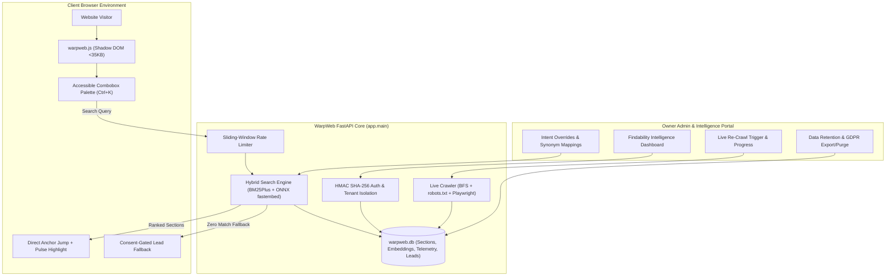

# WarpWeb ⚡

> **High-Precision Intent Navigation & Findability Intelligence for Business Websites**

WarpWeb is an embeddable, low-latency **hybrid search and intent-driven navigation engine** for business websites. Instead of forcing visitors to navigate nested menus or generic site search bars that return irrelevant pages, WarpWeb resolves natural-language visitor queries directly to exact page sections, deep-linking, smooth-scrolling, and pulse-highlighting the answer upon arrival.

For site owners, WarpWeb provides the **Findability Deficit Report**—uncovering the exact queries visitors typed that had zero matches on their site, turning lost visitor intent into actionable business intelligence.

---

## 🎯 What WarpWeb Is and Is NOT

To ensure architectural honesty and realistic expectations:

| What WarpWeb IS | What WarpWeb IS NOT |
| :--- | :--- |
| **High-Precision Section Locator**: Maps user intent to granular page sections using hybrid lexical (BM25+) and semantic (ONNX MiniLM) search. | **NOT a Generative Chatbot**: WarpWeb does not hallucinate free-form text or carry conversational threads. It delivers visitors directly to truthful, existing web content. |
| **Direct Anchor Navigation**: Generates deep links, URL hashes, and W3C text fragments (`#:~:text=...`) to highlight section targets. | **NOT an Autonomous Browser Agent**: WarpWeb does not autonomously fill forms, click buttons, or execute checkouts/bookings on behalf of users. |
| **Deterministic CPU Retrieval**: Combines BM25+, cosine similarity, and keyword/title boosts in sub-15ms on standard CPU. | **NOT an LLM Fine-Tuning Platform**: Zero GPU overhead or query-time API calls to third-party LLMs. No prompt injection or drift risks. |
| **Owner-Governed**: Business owners retain complete control over intent overrides, synonym mappings, and fallback lead capture. | **NOT a Black-Box Scraper**: Ingestion strictly obeys `robots.txt` guidelines and rate limits. |

---

## ✨ Core Capabilities

- ⚡ **Sub-15ms Hybrid Search (CPU)**: Combines **BM25Plus** lexical ranking with dense **ONNX bi-encoder embeddings** (`all-MiniLM-L6-v2`) via `fastembed`, title matching, and intent boosts.
- 🎯 **Truthful Match Attribution**: Every search result explicitly identifies its source: `override`, `hybrid`, `semantic`, or `lexical`.
- 🔍 **Calibrated Confidence Threshold**: Low-confidence queries below the threshold return zero results rather than irrelevant junk, protecting visitor trust.
- 🌐 **Live Crawler & Ingestion Pipeline**:
  - Live BFS crawler obeying domain bounds, max depth, and page limits.
  - Automated `robots.txt` compliance check via `urllib.robotparser`.
  - Static HTML parsing with BeautifulSoup, plus optional Playwright headless browser rendering for JavaScript-rendered SPAs.
  - Automatic linked PDF text extraction and section indexing via `pypdf`.
  - Nested section deduplication (keeps specific content sections, discards redundant wrappers).
  - Stable anchor locator fallback (generates slug IDs, DOM paths, and W3C text fragments for pages without IDs).
  - SHA-256 content change detection for incremental re-indexing.
- 🧩 **Zero-Dependency Shadow DOM Widget (<35KB)**:
  - Isolated from host page CSS/JS.
  - Full **W3C ARIA 1.2 accessibility** (combobox/listbox pattern, `aria-expanded`, `aria-activedescendant`).
  - Keyboard navigation (`↑`/`↓` cycle, `Enter` select, `Escape` close, focus trap & restoration).
  - In-flight request cancellation via `AbortController` and request sequencing to prevent race conditions.
  - Mobile responsive UI (`@media (max-width: 640px)`).
  - Server-driven dynamic intent suggestions.
- 📊 **Owner Findability & Telemetry Dashboard**:
  - **Findability Deficit**: Reports top zero-match queries to identify missing products, services, or FAQs.
  - **Click-Through Tracking & Satisfaction Feedback**: Tracks result clicks, average click rank, and positive/negative search feedback.
  - **Background Re-Crawling**: Trigger live crawling from the dashboard with real-time status polling.
  - **Manual Intent Overrides & Synonyms**: Pin critical business queries directly to target URLs or define bilingual/Hinglish aliases.
- 🛡️ **Enterprise Security & Compliance (Phase 0 & 5)**:
  - HMAC SHA-256 API key authentication with strict tenant isolation.
  - Sliding-window rate limiting on public search and lead submission.
  - Safe DOM construction across widget and dashboard (zero dynamic `innerHTML` interpolation).
  - Consent-gated lead capture with timestamp and notice text persistence.
  - GDPR / data rights compliance: site data export (`GET /api/export/{site_id}`), lead deletion, site purging, and retention cleanup.

---

## 📈 Benchmark & Evaluation Results

Tested against the evaluation harness (`eval/evaluate.py`) across **119 real-world queries** (hospital & e-commerce domains, including exact matches, paraphrases, Hinglish queries, and negative queries):

| Metric | Phase 1 Baseline (Lexical BM25) | Phase 2+ Hybrid (BM25+ & MiniLM) | Improvement |
| :--- | :---: | :---: | :---: |
| **Top-1 Exact Match** | 61.62% | **71.72%** | **+10.1%** |
| **Top-1 Page Match** | 74.75% | **83.84%** | **+9.09%** |
| **Recall@5 Exact** | 87.88% | **95.96%** | **+8.08%** |
| **Recall@5 Page** | 94.95% | **97.98%** | **+3.03%** |
| **MRR (Mean Reciprocal Rank)** | 0.7200 | **0.8210** | **+0.1010** |
| **Hinglish Top-1 Accuracy** | 50.00% | **69.23%** | **+19.23%** |
| **Hinglish Recall@5** | 73.08% | **92.31%** | **+19.23%** |
| **False Positive Rate** | 0.00% | 0.00% | *0.00% (Clean)* |
| **p50 Search Latency (CPU)** | 0.25 ms | **8.52 ms** | *Sub-10ms* |
| **p95 Search Latency (CPU)** | 0.37 ms | **11.64 ms** | *Well within target* |

---

## 🏗️ Architecture



---

## 📁 Repository Structure

```
WarpWeb/
├── backend/                       # FastAPI backend, indexing & crawler engine
│   ├── app/
│   │   ├── crawler/
│   │   │   ├── sectionizer.py     # Semantic sectionizer, deduplication, stable anchors
│   │   │   ├── live_crawler.py    # BFS live-domain crawler with robots.txt & PDF support
│   │   │   └── crawler_batch.py   # Batch demo crawler
│   │   ├── indexer/
│   │   │   ├── hybrid_search.py   # BM25Plus + dense embedding hybrid ranker
│   │   │   └── embeddings.py      # ONNX bi-encoder CPU embedding service
│   │   ├── db/
│   │   │   └── storage.py         # SQLite persistence, migrations, telemetry & compliance
│   │   ├── security/
│   │   │   ├── auth.py            # HMAC SHA-256 API key & tenant isolation
│   │   │   └── rate_limiter.py    # Memory-based sliding-window rate limiters
│   │   ├── models.py              # Pydantic v2 schemas and validation
│   │   └── main.py                # REST API endpoints & widget server
│   ├── tests/                     # 31 unit & integration pytest tests
│   └── requirements.txt
│
├── widget/                        # Zero-dependency TypeScript Shadow DOM widget
│   ├── src/
│   │   └── warpweb.ts             # ARIA 1.2 compliant combobox & routing logic
│   ├── dist/
│   │   └── warpweb.js             # Compiled bundle (<35KB)
│   ├── test/                      # Node.js automated test runner tests
│   └── package.json
│
├── dashboard/                     # Owner admin portal
│   └── index.html                 # Findability KPI cards, telemetry, re-crawl UI
│
├── eval/                          # Quantitative retrieval evaluation harness
│   ├── queries.json               # 119 ground-truth evaluation queries
│   ├── evaluate.py                # Retrieval metrics & latency benchmark script
│   └── BASELINE.md                # Phase 1 baseline evaluation records
│
├── demo/                          # Multi-page interactive demo sites
│   ├── index.html                 # Demo launcher
│   ├── apexcare/                  # Multi-page hospital clinic site
│   └── shoppulse/                 # Multi-page e-commerce audio site
│
├── SECURITY.md                    # Detailed security policy & threat model
└── README.md
```

---

## ⚙️ Configuration & Environment Variables

| Variable | Default | Description |
| :--- | :--- | :--- |
| `WARPWEB_DB_PATH` | `warpweb.db` | Path to the SQLite database file. |
| `WARPWEB_EMBED_MODEL` | `sentence-transformers/all-MiniLM-L6-v2` | FastEmbed ONNX embedding model name. |
| `WARPWEB_ALLOWED_ORIGINS` | `http://localhost:3000,http://127.0.0.1:3000,http://localhost:8000,http://127.0.0.1:8000` | Comma-delimited list of allowed CORS origins. |
| `WARPWEB_SEARCH_IP_LIMIT` | `60` | Max search requests per visitor IP per 60s window. |
| `WARPWEB_SEARCH_SITE_LIMIT` | `600` | Max search requests per site ID per 60s window. |

---

## 🚀 Getting Started

### 1. Prerequisites
- Python 3.10+
- Node.js 18+

### 2. Backend Setup
```bash
cd backend
python3 -m venv venv
source venv/bin/activate
pip install -r requirements.txt
```

Index demo sites:
```bash
PYTHONPATH=backend python3 app/crawler/crawler_batch.py
```

Run backend test suite (31 tests):
```bash
PYTHONPATH=backend pytest tests/
```

Run quantitative retrieval evaluation:
```bash
python3 eval/evaluate.py
```

Start the API server:
```bash
uvicorn app.main:app --host 0.0.0.0 --port 8000 --app-dir backend
```

### 3. Widget Setup & Compilation
```bash
cd widget
npm install
npm test
npm run build
```

### 4. Run Demos & Dashboard
Serve the frontend demo environment:
```bash
python3 -m http.server 3000
```
- **Demo Launcher**: [`http://localhost:3000/demo/index.html`](http://localhost:3000/demo/index.html)
- **ApexCare Clinic (5 Pages)**: [`http://localhost:3000/demo/apexcare/index.html`](http://localhost:3000/demo/apexcare/index.html)
- **PulseTech Audio (5 Pages)**: [`http://localhost:3000/demo/shoppulse/index.html`](http://localhost:3000/demo/shoppulse/index.html)
- **Owner Findability Dashboard**: [`http://localhost:3000/dashboard/index.html`](http://localhost:3000/dashboard/index.html)

---

## 💡 Embedding on a Website

Add the lightweight script tag to the `<head>` or before `</body>`:

```html
<script 
  src="http://localhost:8000/warpweb.js" 
  data-site-id="apexcare-clinic" 
  data-api-host="http://localhost:8000">
</script>
```

---

## ⚠️ Known Limitations & Boundaries

1. **W3C Text Fragments Support**: Scroll-to-text-fragment (`#:~:text=...`) is supported natively in Chromium-based browsers (Chrome, Edge, Brave, Opera) and Safari 16.1+. Firefox supports section anchor hashes (`#section-id`) and gracefully falls back to top-of-page navigation for unanchored text fragments.
2. **Page Semantic Structure**: Search quality is highest when target web pages use hierarchical HTML (`<section>`, `<article>`, `<h1>`-`<h6>`). Single unformatted generic `<div>` containers will produce coarse sections.
3. **In-Memory Embedding Scaling**: The current bi-encoder architecture evaluates embeddings via in-memory vector dot-products. This achieves sub-15ms search latencies for sites with up to ~50,000 sections. For sites exceeding 50,000 sections, an external vector index (e.g. Qdrant or Milvus) is recommended.

---

## 📄 License
MIT License. See [LICENSE](LICENSE) for details.
