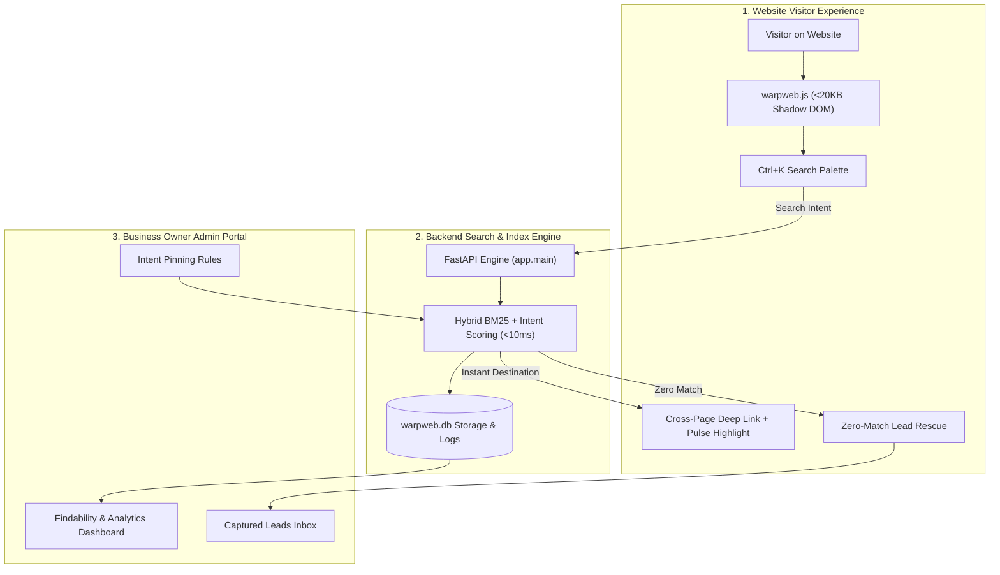

# WarpWeb ⚡

> **"Stop navigating websites. Tell them what you want."**

WarpWeb is an embeddable, sub-10ms **intent-driven navigation & findability engine** for business websites. Instead of forcing visitors to scour multi-nested menus, links, and pages, WarpWeb resolves natural-language visitor intent directly to cross-page deep links, auto-scrolling and pulse-highlighting the target section upon arrival.

For website owners, WarpWeb provides the **Findability Deficit Report**—uncovering the exact queries visitors typed that had zero matches on their site, turning lost visitors into actionable revenue opportunities and warm leads.

---

## ✨ Features

- ⚡ **Sub-10ms Instant Navigation**: Hybrid search (BM25 lexical + intent boosting) delivering results in under 10ms with zero GPU or query-time LLM overhead.
- 🚀 **Cross-Page Deep Arrival**: Seamlessly bridges different pages. When a visitor selects a target on another page, WarpWeb navigates them and triggers an automatic smooth-scroll & pulse-highlight effect when the page renders.
- 🧩 **Isolated Shadow DOM Client Widget (<20KB)**: Drop-in single `<script>` embed that never clashes with existing website styles or scripts. Accessible globally via `Ctrl+K` or a floating launcher button.
- ⚠️ **Findability Deficit & Zero-Match Analytics**: The primary B2B value wedge. Shows owners what visitors searched for that their website *doesn't* answer.
- 📞 **One-Click Lead Rescue**: When visitors search for something unavailable, an integrated fallback form captures their phone or WhatsApp number for an immediate callback.
- 📌 **Intent Pinning & Overrides**: Business owners can manually pin commercial keywords (e.g., *"Dr. Sharma timings"* or *"return policy"*) directly to high-priority URLs.

---

## 🏗️ Architecture



---

## 📁 Repository Structure

```
WarpWeb/
├── backend/                  # FastAPI backend, indexing & crawler engine
│   ├── app/
│   │   ├── crawler/          # HTML sectionizer and multi-page crawler
│   │   ├── indexer/          # Sub-10ms BM25 hybrid intent scoring
│   │   ├── db/               # SQLite storage, analytics, leads & overrides
│   │   ├── models.py         # Pydantic data schemas
│   │   └── main.py           # REST API endpoints & widget server
│   └── requirements.txt
│
├── widget/                   # Lightweight standalone TypeScript client widget
│   ├── src/
│   │   └── warpweb.ts        # Widget source with Shadow DOM & cross-page routing
│   ├── dist/
│   │   └── warpweb.js        # Compiled production bundle (<20KB)
│   └── package.json
│
├── dashboard/                # Business owner admin & findability intelligence portal
│   └── index.html            # Real-time analytics, lost queries, and intent pinning
│
├── demo/                     # Live multi-page interactive demos
│   ├── index.html            # Showcase launcher
│   ├── apexcare/             # 5-page hospital clinic website
│   │   ├── index.html
│   │   └── pages/            # departments, doctors, diagnostics, insurance
│   └── shoppulse/            # 5-page high-consideration D2C audio store
│       ├── index.html
│       └── pages/            # headphones, earbuds, specs, return policy
│
└── COMMERCIAL_PITCH.md       # B2B SaaS pitch deck & monetization strategy
```

---

## 🚀 Quickstart & Local Setup

### 1. Prerequisites
- Python 3.10+
- Node.js 18+

### 2. Backend Setup
```bash
cd backend
python3 -m venv venv
source venv/bin/activate
pip install -r requirements.txt
```

Run multi-page site ingestion:
```bash
PYTHONPATH=backend python3 app/crawler/crawler_batch.py
```

Start the API engine:
```bash
uvicorn app.main:app --host 0.0.0.0 --port 8000 --app-dir backend
```

### 3. Client Widget Compilation (Optional if editing TS)
```bash
cd widget
npm install
npm run build # or: ./node_modules/typescript/bin/tsc src/warpweb.ts --outDir dist --target es2020
```

### 4. Run the Demo & Admin Dashboard
Serve the demo websites and admin dashboard:
```bash
python3 -m http.server 3000
```

- **Interactive Showcases Launcher**: [`http://localhost:3000/demo/index.html`](http://localhost:3000/demo/index.html)
- **ApexCare Hospital (5 Pages)**: [`http://localhost:3000/demo/apexcare/index.html`](http://localhost:3000/demo/apexcare/index.html)
- **PulseTech Audio Store (5 Pages)**: [`http://localhost:3000/demo/shoppulse/index.html`](http://localhost:3000/demo/shoppulse/index.html)
- **Owner Findability Dashboard**: [`http://localhost:3000/dashboard/index.html`](http://localhost:3000/dashboard/index.html)

---

## 💡 How to Embed on Any Website

Simply paste this single line inside your website's `<head>` or footer:

```html
<script src="https://cdn.warpweb.ai/warpweb.js" data-site-id="your-site-id" data-api-host="https://api.warpweb.ai"></script>
```

---

## 📄 License
MIT
